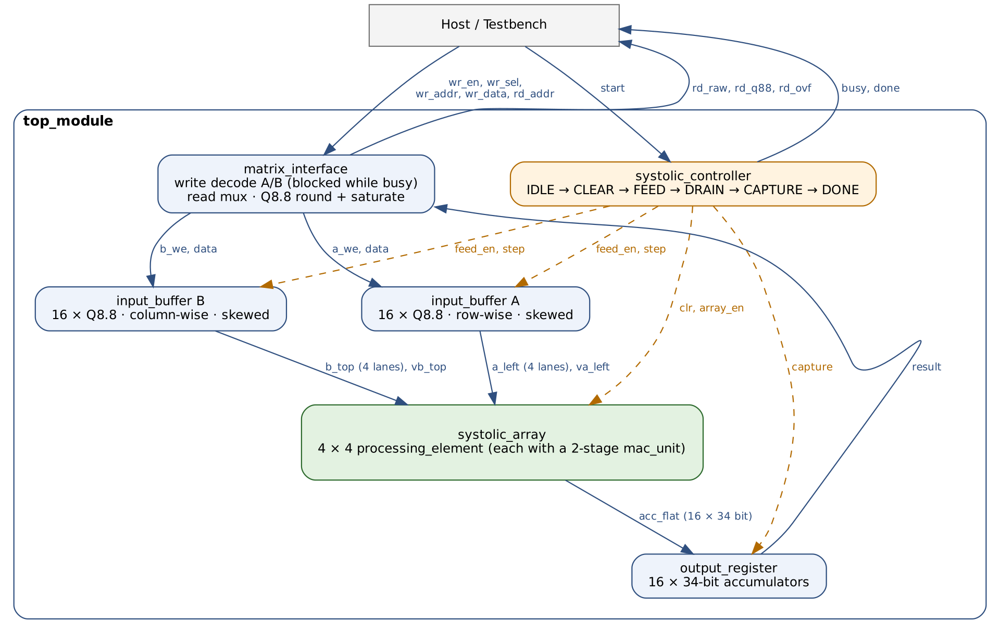
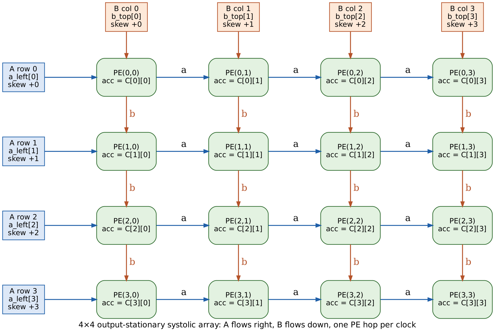
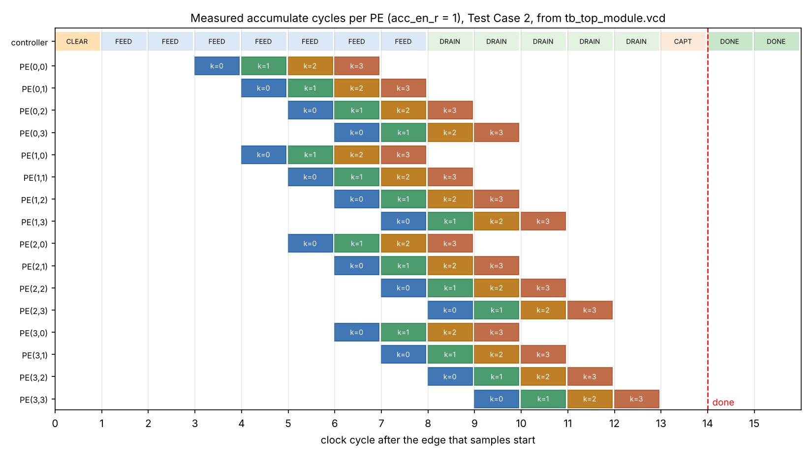

# 4×4 Systolic Array Accelerator for Matrix Multiplication (Verilog HDL)

B.Tech Digital Design / Computer Architecture project (Project 12).
A synthesizable, verified output-stationary systolic array that computes
**C = A × B** for 4×4 matrices of signed Q8.8 fixed-point numbers.

| | |
|---|---|
| Array | 4×4 = 16 processing elements, one MAC each |
| Arithmetic | signed Q8.8 operands, 34-bit full-precision accumulators (overflow-free) |
| Latency | **14 clock cycles** start → done (sequential baseline: 64) |
| Throughput | 1 product per 15 cycles sustained (baseline: 65) |
| Verification | 4 self-checking testbenches, 108 system-level cases + mutation testing, all passing |
| FPGA (Lattice ECP5-25F, post-route) | 16 MULT18X18D, 1 787 LUT4, 2 150 FF, median Fmax **122 MHz** |
| Speed-up vs sequential (FPGA time) | **6.7× latency, 6.4× throughput** |

## Objectives

* Design a processing element that performs signed multiply-accumulate and passes data to its neighbours.
* Connect 16 PEs into a 4×4 systolic array with correct horizontal (A) and vertical (B) data movement.
* Add input buffering with diagonal skew, an output register, an FSM controller and a host interface.
* Verify against an independent reference model, including negative and fractional values.
* Measure latency, throughput and FPGA resources, and compare with a sequential multiplier.

## Architecture





| Module | Role |
|---|---|
| `rtl/mac_unit.v` | 2-stage signed MAC: `prod_r <= a*b`, then `acc <= acc + prod_r` |
| `rtl/processing_element.v` | MAC + forwarding registers (A → right, B → down, with valid bits) |
| `rtl/systolic_array.v` | 4×4 grid built with `generate`; flattened Verilog-2001 buses |
| `rtl/input_buffer.v` | Stores one matrix; emits skewed lanes (row-wise for A, column-wise for B) |
| `rtl/output_register.v` | Captures all 16 accumulators in one clock |
| `rtl/systolic_controller.v` | FSM: IDLE → CLEAR → FEED (7) → DRAIN (5) → CAPTURE → DONE |
| `rtl/matrix_interface.v` | Host write port, result read mux, Q8.8 rounding and saturation with overflow flag |
| `rtl/top_module.v` | Integration |
| `rtl/sequential_matmul.v` | Single-MAC baseline with the same interface, for comparison |

**Fixed-point format.** Operands are Q8.8: value = integer / 256, range
−128.0 to +127.996. Products are Q16.16. Accumulators keep all bits
(`rd_raw`, value = integer / 65536). `rd_q88` is the result rounded to
nearest and saturated to Q8.8, and `rd_ovf` flags saturation.

**Dataflow.** Row *i* of A enters PE(i,0) delayed by *i* cycles. Column *j*
of B enters PE(0,j) delayed by *j* cycles. A moves right and B moves down
one PE per clock, so `A[i][k]` and `B[k][j]` meet in PE(i,j) at cycle
*k + i + j*. The chart below was extracted from the simulation VCD:



## Technologies

Verilog-2005 · Icarus Verilog 12.0 · GTKWave 3.3 · Yosys 0.33 · nextpnr-ecp5 · Graphviz · Python (NumPy, Matplotlib) · LaTeX (IEEEtran)

## Directory structure

```
systolic-array-accelerator/
├── rtl/                     8 design modules + sequential baseline
├── testbench/               tb_processing_element, tb_systolic_array, tb_top_module, tb_sequential_matmul
├── simulation/
│   ├── compile.sh           compile all testbenches
│   ├── run_simulation.sh    compile + run + summary
│   ├── logs/                compile, simulation, reference-model, mutation and timing logs
│   └── waveforms/           VCD files + GTKWave layouts (.gtkw)
├── synthesis/               Yosys/nextpnr scripts, logs, seed sweep, experiments/
├── project_artifacts/
│   ├── screenshots/         terminal and GTKWave captures
│   └── diagrams/            Graphviz sources (.dot) + PNG/SVG
├── docs/                    IEEE report (PDF + LaTeX), performance analysis, design review,
│                            demo script, reference model, VCD timing extractor
├── scripts/                 capture_mac_screenshots.sh
├── Makefile
└── README.md
```

## Installation (macOS)

```bash
brew install icarus-verilog gtkwave yosys graphviz
# optional, for FPGA place-and-route:
pip3 install yowasp-nextpnr-ecp5
```

On Linux (Ubuntu/Debian): `sudo apt install iverilog gtkwave yosys graphviz`.

## Compile and simulate

```bash
make compile      # or ./simulation/compile.sh
make sim          # or ./simulation/run_simulation.sh
```

Manual equivalent for the full system:

```bash
iverilog -g2005 -Wall -s tb_top_module -o tb_top.vvp rtl/*.v testbench/tb_top_module.v
vvp -n tb_top.vvp
```

Run from the repository root, because the testbenches write VCDs to `simulation/waveforms/`.

### Expected output

```
PE TESTBENCH: 109 checks, 0 errors -> PASS
ARRAY TESTBENCH: 54 passed, 0 failed -> PASS
TOP TESTBENCH: 108 test cases passed, 0 failed -> PASS
Measured latency start->done: 14 cycles
SEQUENTIAL BASELINE: 20 cases, 0 failed -> PASS
ALL TESTBENCHES PASSED
```

Test Case 2 (from `simulation/logs/sim_top_module.log`):

```
A = [1 2 3 4; 5 6 7 8; 9 1 2 3; 4 5 6 7]
B = [1 2 0 1; 0 1 2 0; 1 0 1 2; 2 1 0 1]
C = [12 8 7 11; 28 24 19 27; 17 22 4 16; 24 20 16 23]   (hardware = expected)
```

The cross-check against an independent NumPy model is in
`python3 docs/reference_model.py`.

## Waveforms (GTKWave)

```bash
make wave       # control, skewed inputs, accumulators, result port
make wave-pe    # A moving right along row 0, B moving down column 0
cd simulation/waveforms && gtkwave tb_top_module.vcd accumulator_signals.gtkw
```

The saved layouts open at Test Case 2 (t = 880 ns). In these views,
signed values are shown as raw integers: inputs use 256 = 1.0, and
accumulators use 65536 = 1.0.

## Synthesis

```bash
make synth                        # Yosys generic + Xilinx 7-series mapping
./synthesis/run_pnr_ecp5.sh       # place-and-route on Lattice ECP5-25F
```

## Performance summary

| | Systolic | Sequential |
|---|---|---|
| Latency (cycles) | 14 | 64 |
| Sustained period (cycles) | 15 | 65 |
| ECP5 median Fmax | 122.04 MHz | 83.19 MHz |
| Latency (ns) | 114.7 | 769.3 |
| Multipliers | 16 | 1 |

The full methodology, resource tables and design-space experiments are
in [`docs/performance_analysis.md`](docs/performance_analysis.md). The
second-pass review and mutation testing are in [`docs/design_review.md`](docs/design_review.md).

## About the screenshots

The images in `project_artifacts/screenshots/` are real captures of
GTKWave and a terminal running this project's actual commands. They were
taken on a Linux build machine (stated in each terminal capture). To
produce macOS captures, run `./scripts/capture_mac_screenshots.sh`.

## Future enhancements

* Overlap consecutive jobs (double-buffered accumulators) to raise PE utilization above 26.7 %.
* Wider or AXI-Stream input ports so loading is not slower than compute.
* Tile larger matrices over the 4×4 array.
* Configurable precision (INT8, bfloat16) for ML workloads.
* Run on a physical FPGA board with a UART host interface.

## Author

Yash Dhankhar, Newton School of Technology, Rishihood University.
